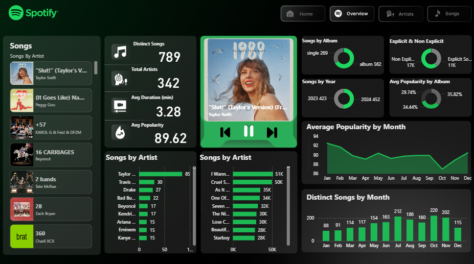
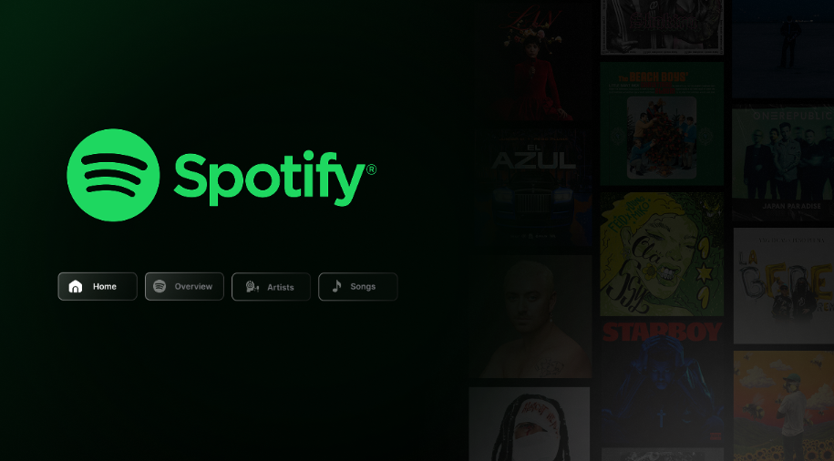
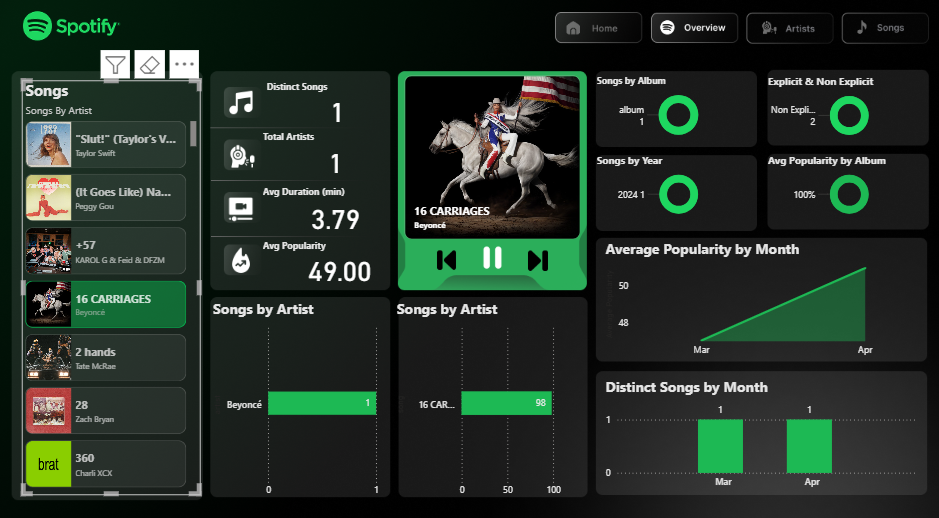
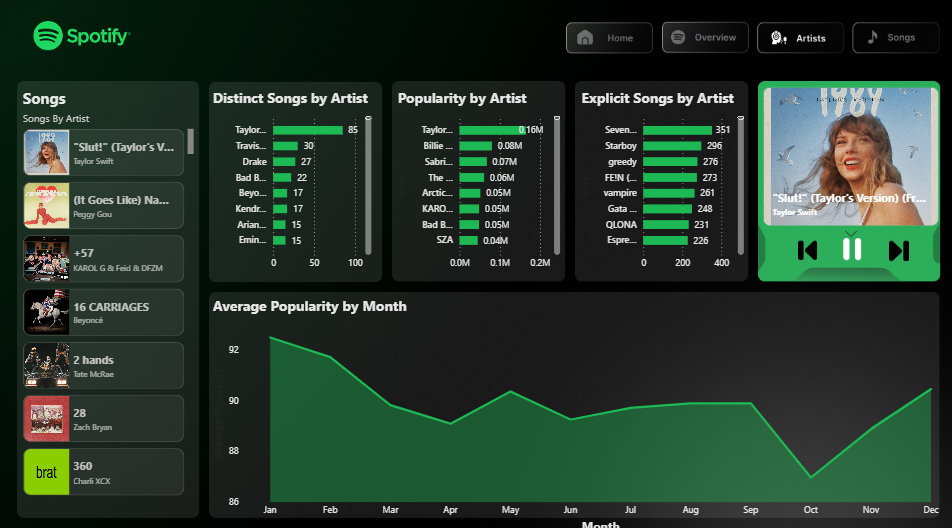
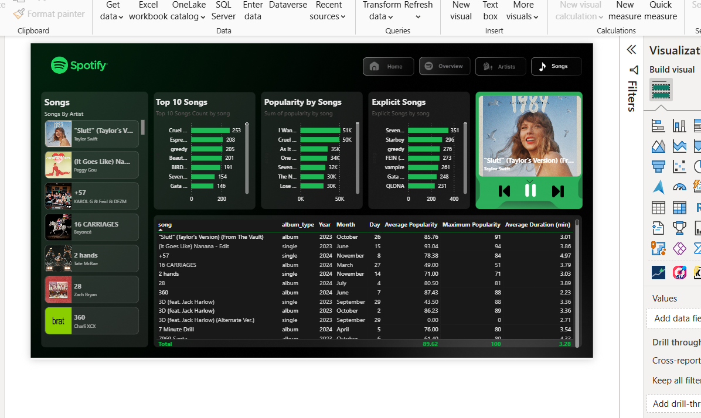

# Spotify Interactive Power BI Dashboard

An interactive, sleek, dark-themed **Spotify Data Dashboard** built using **Power BI**. This project replicates the modern Spotify user interface while delivering deep data insights into music trends, artist popularity, song distributions, and listening habits.

---

## 🚀 Dashboard Interface Preview

### Main Overview
<p align="center">
  
</p>

### Feature & View Breakdown
<p align="center">
  
  
</p>
<p align="center">
  
  
</p>

---

## 📊 Key Features & Visuals

* **Spotify UI Replication:** Built with a custom dark mode theme, featuring official Spotify branding, integrated album art, and intuitive navigation buttons (Home, Overview, Artists, Songs).
* **High-Level KPI Cards:** Instantly view core metrics such as **Distinct Songs (789)**, **Total Artists (342)**, **Average Song Duration (3.28 min)**, and **Average Popularity (89.62)**.
* **Music Player Visual:** A central creative tile stylized as an active music player showcasing trending tracks like Taylor Swift's *"Slut! (Taylor's Version)"*.
* **Artist & Song Analytics:** * *Songs by Artist* breakdown tracking top streaming contributors (e.g., Taylor Swift, Travis Scott, Drake).
  * *Stream Count Breakdown* showing total plays/reach per track.
* **Donut Chart Distributions:** * *Songs by Album:* Comparison between singles vs. full albums.
  * *Explicit vs. Non-Explicit:* Tracking mature vs. clean content distribution.
  * *Songs by Year & Popularity:* Breakdown across release years (2023 vs. 2024) and popularity brackets.
* **Time-Series Insights:**
  * *Average Popularity by Month:* A green area line chart tracking seasonal popularity fluctuations.
  * *Distinct Songs by Month:* A clean bar chart monitoring content distribution month-over-month.

---

## 🧮 DAX Measures & Data Modeling

To power the dynamic KPI cards and interactive charts on this dashboard, the following core **DAX (Data Analysis Expressions)** formulas were implemented.

---

## 🛠️ Tech Stack & Tools

* **Business Intelligence Tool:** Power BI Desktop
* **Data Transformation:** Power Query (ETL process, data cleaning, and type casting)
* **Design & Layout:** Custom UI shapes, themed icon packs, and conditional formatting to achieve the Spotify aesthetic.

---

## ⚙️ How to View the Project

1.  **Clone the Repository:**
    ```bash
    git clone [https://github.com/M-Awad-27/Spotify-Interactive-Dashboard.git]
    ```
2.  **Open in Power BI:**
    * Make sure you have [Power BI Desktop](https://powerbi.microsoft.com/) installed.
    * Open the `.pbix` file included in this repository.
3.  **Explore the Dashboard:** Use the top slicer buttons and interactive bar/donut charts to filter data dynamically by artist, month, or content type.

---

## 🤝 Contributing
Contributions, issues, and feature requests are welcome! Feel free to check out the issues page if you want to suggest improvements to the layout or data metrics.

## 📝 License
This project is open-source and available under the [MIT License](LICENSE).

## 👨‍💻 Author

<h1 align="center">
  🍁 Made by <span style="color: #FF0055;">M</span><span style="color: #00E5FF;">A</span> 🍁
</h1>
